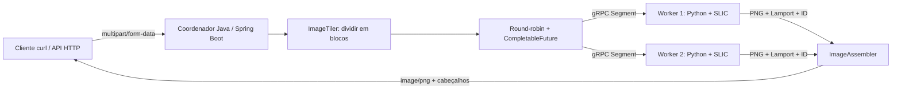

# Segmentação Distribuída de Imagens com SLIC, gRPC e Relógios de Lamport

Implementação do **Trabalho Prático de Computação Distribuída — PUC Minas (2026/2)**. O sistema divide uma imagem em blocos retangulares, envia os blocos a processos trabalhadores (*workers*) Python por meio de **gRPC/Protocol Buffers**, executa **SLIC** (`scikit-image`) em cada bloco e devolve ao cliente a imagem reconstruída pelo **coordenador Java/Spring Boot** via **HTTP REST**.

> **Escopo implementado:** segmentação SLIC **independente por bloco** (não equivale exatamente à segmentação SLIC global da imagem). Os testes publicados foram realizados com **dois containers workers e um coordenador na mesma máquina física**. Não há demonstração de aceleração (*speedup*) em comparação controlada com uma implementação sequencial.

**Repositório:** <https://github.com/FelipeSilva96/Trabalho_pratico_computacao_distribuida> (branch `main`).

## Índice

1. [O que o sistema faz](#o-que-o-sistema-faz)
2. [Arquitetura e comunicação](#arquitetura-e-comunicação)
3. [Tecnologias e requisitos](#tecnologias-e-requisitos)
4. [Pré-requisitos](#pré-requisitos)
5. [Executar com Docker Compose](#executar-com-docker-compose)
6. [Executar e visualizar a primeira segmentação](#executar-e-visualizar-a-primeira-segmentação)
7. [Referência da API](#referência-da-api)
8. [Parâmetros e comportamento do SLIC](#parâmetros-e-comportamento-do-slic)
9. [Testes automatizados](#testes-automatizados)
10. [Testar distribuição, paralelismo e recuperação](#testar-distribuição-paralelismo-e-recuperação)
11. [Resultados experimentais da primeira entrega](#resultados-experimentais-da-primeira-entrega)
12. [Executar serviços em máquinas diferentes](#executar-serviços-em-máquinas-diferentes)
13. [Estrutura de arquivos](#estrutura-de-arquivos)
14. [Solução de problemas](#solução-de-problemas)
15. [Limitações e melhorias possíveis](#limitações-e-melhorias-possíveis)
16. [Participantes, IA e referências](#participantes-ia-e-referências)

## O que o sistema faz

Uma única imagem é dividida em uma grade configurável, por exemplo, **2 linhas × 2 colunas**. Cada bloco recebe um ID (`r0c0`, `r0c1`, `r1c0`, `r1c1`), coordenadas de origem, dimensões e dados de imagem codificados em PNG. O coordenador agenda tarefas concorrentes com `CompletableFuture`, escolhe o worker por *round-robin* e usa gRPC para enviar uma solicitação `SegmentRequest`. O worker executa `skimage.segmentation.slic`, realça os limites dos superpixels em vermelho e retorna `SegmentResponse`. O coordenador monta os blocos nas posições originais e devolve o PNG final.

A aplicação também preserva um **protótipo anterior de classificação distribuída de resíduos**. Essa função antiga opera por padrão em **modo DEMO**, no qual os rótulos são derivados deterministicamente dos bytes da imagem. **Não confunda o modo DEMO da classificação antiga com a segmentação SLIC: a segmentação usa um algoritmo real.**

### Fluxo simplificado



O `ImageTiler` processa larguras e alturas ímpares sem omitir pixels; `ImageAssembler` recompõe os resultados por coordenadas, independentemente da ordem de chegada. O resultado SLIC não é um mapa semântico de objetos (por exemplo, ele não identifica automaticamente cada garrafa).

## Arquitetura e comunicação

| Componente | Responsabilidades | Implementação |
|---|---|---|
| **Cliente** | Enviar imagem e parâmetros; salvar/exibir PNG | `curl`, Postman ou outro cliente HTTP |
| **Coordenador** | Validar imagem, dividir, distribuir, aplicar deadline e nova tentativa, atualizar Lamport, reconstruir resultado | Java 17, Spring Boot 3.3.5 |
| **Worker 1** | Receber blocos, segmentar, devolver resultado e timestamp | Python 3.11 + servidor gRPC |
| **Worker 2** | Mesmo processamento, em processo separado | Python 3.11 + servidor gRPC |
| **Protobuf** | Definir o contrato binário entre Java e Python | `classifier.proto` (cópias no Java e Python) |

**Rede padrão Docker Compose:** `cd-network` (bridge). Dentro dessa rede, o coordenador acessa `worker-1:50051` e `worker-2:50051`; ambas são portas **internas**. Na máquina hospedeira, as portas publicadas são **50051** (Worker 1) e **50052** (Worker 2). O serviço HTTP publica a porta **8080**.

A API externa utiliza REST/HTTP; os serviços internos usam gRPC. Cada processo mantém um relógio lógico de Lamport. Quando envia uma mensagem, incrementa seu relógio; ao receber timestamp `T`, executa `C = max(C, T) + 1`. Os clocks são thread-safe (`AtomicLong` em Java e `threading.Lock` em Python). Relógios de Lamport **não sincronizam a hora real** nem determinam concorrência a partir de timestamps numéricos apenas.

## Tecnologias e requisitos

| Tecnologia | Finalidade |
|---|---|
| Java 17, Maven 3.9.9 | Coordenador e build |
| Spring Boot 3.3.5 | API REST |
| gRPC Java/Python + Protocol Buffers | Chamadas de procedimentos remotos e serialização |
| Python 3.11 | Processamento nos workers |
| Pillow, NumPy, scikit-image | Leitura, matrizes de pixels e algoritmo SLIC |
| Docker + Docker Compose | Execução de processos em containers isolados |
| JUnit | Testes Java de Lamport e montagem |

Na primeira entrega foram implementados **RPC**, **relógios lógicos de Lamport** e **Web Services REST**, além de paralelização de tarefas e uma estratégia básica de *failover*. Não existem eleição de líder nem consenso distribuído. O coordenador é um **ponto único de falha**.

## Pré-requisitos

### Opção recomendada: Docker

- Sistema Linux, Windows com Docker Desktop/WSL2 ou macOS;
- Docker Engine/CLI funcionando;
- plugin **Docker Compose v2** (`docker compose`);
- acesso à internet **na primeira construção** para baixar imagens e dependências;
- portas **8080, 50051 e 50052** livres no host;
- armazenamento e memória suficientes para Maven/Java, Python e o processamento das imagens.

**Não é necessário instalar Java, Python, Maven ou scikit-image no computador hospedeiro** se você usar o Docker Compose. Esses componentes são instalados dentro das imagens durante o build.

Verifique a instalação:

```bash
docker --version
docker compose version
docker info
```

No Linux, se a permissão ao daemon Docker falhar, use `sudo` antes dos comandos `docker`. As operações com `curl`, `git`, `sha256sum` e `mvn` não exigem `sudo` por padrão.

### Opção sem Docker (para desenvolver)

Requer Java 17, Maven, Python 3.11, `pip` e gRPC. Nesse caso, é necessário iniciar manualmente os dois workers e o coordenador, configurar `WORKER_ADDRESSES` e ajustar portas/ambientes. Para reproduzir a configuração testada, **prefira Docker Compose**.

## Executar com Docker Compose

### 1. Clonar o repositório

```bash
git clone https://github.com/FelipeSilva96/Trabalho_pratico_computacao_distribuida.git
cd Trabalho_pratico_computacao_distribuida
```

Certifique-se de estar na **raiz**, onde está `docker-compose.yml`:

```bash
ls docker-compose.yml coordinator worker
```

### 2. Construir e iniciar

```bash
docker compose up -d --build
```

Se necessário no Linux:

```bash
sudo docker compose up -d --build
```

Na primeira execução, o Docker poderá demorar ao baixar imagens-base, dependências Maven e pacotes Python. Construções seguintes aproveitam o cache. O aviso de que `buildx` não está instalado nem sempre impede o build; verifique o resultado final antes de diagnosticar erro.

**Os serviços esperados são:** `cd-waste-coordinator`, `cd-waste-worker-1` e `cd-waste-worker-2`.

### 3. Conferir os processos

```bash
docker compose ps
```

Os três devem estar com status `Up`/`running` (essa verificação, sozinha, não garante resposta RPC).

### 4. Testar HTTP e workers

```bash
curl -i http://localhost:8080/api/health
curl -s http://localhost:8080/api/workers
```

`/api/health` informa o estado do coordenador; `/api/workers` consulta os workers pela infraestrutura gRPC. Dois resultados com `status: "UP"` indicam que ambos responderam.

### 5. Consultar logs

```bash
docker compose logs --tail=100 coordinator
docker compose logs --tail=100 worker-1 worker-2
```

Para acompanhar continuamente:

```bash
docker compose logs -f coordinator worker-1 worker-2
```

Para **parar e remover os containers e a rede** (sem apagar as imagens geradas):

```bash
docker compose down
```

Para **iniciar novamente sem reconstruir**:

```bash
docker compose up -d
```

## Executar e visualizar a primeira segmentação

Todos os exemplos são executados na **raiz do repositório**. Escolha um arquivo local de imagem e substitua `foto.jpg` pelo seu caminho. Há uma fotografia de teste versionada no projeto (`imagem_teste_grande.jpg`); antes de redistribuí-la, confira direitos e créditos de uso.

### Exemplo A — imagem inteira enviada a um worker

```bash
curl -fS -D cabecalhos_unico.txt \
  -F 'file=@imagem_teste_grande.jpg' \
  -F 'segments=500' \
  -F 'compactness=10.0' \
  http://localhost:8080/api/segment \
  --output resultado_unico.png

cat cabecalhos_unico.txt
```

A rota `/api/segment` envia **a imagem inteira para um worker**, sem divisão. Retorna `Content-Type: image/png` e cabeçalho `X-Worker-Id`.

### Exemplo B — uma imagem dividida entre workers (principal)

```bash
curl -fS -D cabecalhos_teste.txt \
  -F 'file=@imagem_teste_grande.jpg' \
  -F 'segments=500' \
  -F 'compactness=10.0' \
  -F 'rows=2' \
  -F 'cols=2' \
  http://localhost:8080/api/segment-distributed \
  --output resultado_teste.png

cat cabecalhos_teste.txt
```

A opção `-fS` faz o `curl` reportar erros HTTP, `-D` grava cabeçalhos em arquivo e `--output` salva os bytes do PNG. **Não utilize `curl` sem `--output` para uma resposta binária**, pois o terminal poderá receber bytes ilegíveis.

Abra o resultado:

```bash
xdg-open resultado_teste.png  # Linux com interface gráfica
```

No Windows, abra o arquivo salvo pelo Explorador; no macOS, use `open resultado_teste.png`.

Uma resposta bem-sucedida deverá incluir `HTTP/1.1 200` e, conforme disponibilidade dos workers, cabeçalhos semelhantes a:

```http
Content-Type: image/png
X-Tiles: 4
X-Worker-Ids: worker-1,worker-2
X-Tile-Workers: r0c0=worker-1,r0c1=worker-2,r1c0=worker-1,r1c1=worker-2
X-Total-Time-Ms: 3051
```

`3051` é uma **medição histórica de uma execução**; não é um tempo garantido para outros computadores nem outras imagens. Os IDs dos workers podem variar conforme o rodízio e eventuais novas tentativas. O PNG deve ter as mesmas dimensões da imagem de entrada.

### O que acontece em `http://localhost:8080/`?

**Atenção:** na versão atual da `main`, a página HTML inicial ainda é a interface **legada de classificação distribuída de resíduos**. Ela envia imagens para `/api/classify`; **não** é a interface gráfica da nova segmentação. Para usar SLIC, utilize os comandos acima, Postman ou qualquer cliente capaz de enviar `multipart/form-data`.

## Referência da API

| Método | Caminho | Entrada | Saída |
|---|---|---|---|
| GET | `/api/health` | — | JSON do coordenador e relógio lógico |
| GET | `/api/workers` | — | JSON com estado de cada worker |
| POST | `/api/segment` | `file`, `segments`, `compactness` | PNG de um worker; cabeçalhos com o worker e Lamport |
| POST | `/api/segment-distributed` | `file`, `segments`, `compactness`, `rows`, `cols` | PNG reconstruído; cabeçalhos de blocos/workers/tempo |
| POST | `/api/classify` | `files` (um ou mais) | JSON de classificação **legada** |

### `POST /api/segment-distributed`

Envie corpo `multipart/form-data` com:

| Campo | Padrão | Regras reais no código |
|---|---:|---|
| `file` | Obrigatório | imagem legível por `ImageIO`; máximo de arquivo 15 MB configurado no Spring |
| `segments` | `100` | inteiro entre 2 e 5000; distribuído proporcionalmente à área entre os blocos, com mínimo 2 por bloco |
| `compactness` | `8.0` | número real finito e positivo |
| `rows` | `2` | inteiro entre 1 e 8 |
| `cols` | `2` | inteiro entre 1 e 8 |

Outras validações no serviço: imagem de no máximo **16 milhões de pixels**, e cada bloco com pelo menos **16 × 16 pixels**. Dimensões incompatíveis com a grade retornam erro 400. Não interprete `segments` como garantia de número exato de superpixels retornados.

**Cabeçalhos específicos na resposta distribuída:** `X-Request-Id`, `X-Tiles`, `X-Total-Time-Ms`, `X-Coordinator-Lamport`, `X-Worker-Ids`, `X-Tile-Workers` e `Content-Type: image/png`. O corpo **não é JSON**, mas bytes PNG. Quando todos os workers falham, a API retorna um erro HTTP, não uma imagem incompleta.

### `POST /api/segment`

Recebe `file` + `segments` + `compactness` e usa um worker para a imagem inteira. Não oferece `rows` ou `cols`. Não confunda sua duração com a duração medida na versão dividida sem controlar imagem, condições e algoritmo.

### `POST /api/classify` — somente compatibilidade

```bash
curl -s -F 'files=@imagem_teste_grande.jpg' \
  http://localhost:8080/api/classify
```

Essa operação é **legada**. No repositório atual, as dependências Python `torch` e `torchvision` não estão instaladas, e não existe um modelo de classificação treinado versionado. Sem um modelo, o classificador retorna rótulos em modo `DEMO` se `ALLOW_DEMO_CLASSIFIER=true` (padrão do Compose), **não uma classificação visual válida**. Não é necessário instalar PyTorch para executar a segmentação SLIC.

## Parâmetros e comportamento do SLIC

SLIC (*Simple Linear Iterative Clustering*) agrupa pixels vizinhos em **superpixels** com base na proximidade espacial e semelhança visual. No worker, `segmenter.py` converte o bloco recebido em RGB, transforma-o em `numpy.ndarray` e executa `skimage.segmentation.slic`. Depois usa `mark_boundaries` para desenhar os limites vermelhos e salva um PNG.

- `segments`: quantidade **aproximada** desejada no total; o coordenador reparte o alvo por blocos conforme a área. Pode haver diferença entre o solicitado e o obtido.
- `compactness`: ajusta a relação entre regularidade espacial e aderência a diferenças visuais. Valores maiores tendem a favorecer regiões mais regulares, mas o resultado depende da imagem.
- `rows` × `cols`: quantidade de tarefas retangulares, com máximo de 64 blocos (8×8). Mais blocos geram mais mensagens e mais custo de codificação; nem sempre melhoram o tempo total.

**Limitação central:** SLIC é calculado independentemente em cada bloco. Superpixels próximos à linha de corte entre dois blocos não compartilham centros nem informações sobre regiões vizinhas; por isso podem surgir descontinuidades. A saída da API é uma **visualização PNG com bordas**, não uma matriz global de rótulos de superpixels, e não fornece segmentação semântica.

## Testes automatizados

Há **dois testes JUnit** no projeto Java:

- `LamportClockTest`: testa incremento e atualização do relógio lógico ao receber mensagens;
- `ImageTileRoundTripTest`: reconstrói uma imagem sintética de dimensões ímpares (285×177) e compara seus pixels com a imagem original, sem passar por SLIC.

Com Java 17 + Maven instalado localmente:

```bash
cd coordinator
mvn test
cd ..
```

Resultado observado na execução do grupo: **2 testes, 0 falhas, `BUILD SUCCESS`**.

**Importante:** `coordinator/Dockerfile` executa `mvn -DskipTests package`. Logo, `docker compose up --build` **não executa** os testes JUnit. Não há pipeline GitHub Actions na `main` auditada. Também não há testes automatizados de integração gRPC ou testes unitários Python atualmente versionados.

## Testar distribuição, paralelismo e recuperação

### Confirmar quais workers executaram os blocos

```bash
docker compose logs --tail=100 coordinator
```

Procure linhas `[TILE]` com `tile=r0c0`, `worker=worker-1` etc. Verifique `X-Tile-Workers` nos cabeçalhos HTTP para conferir distribuição entre workers.

### Verificar sobreposição temporal

```bash
docker compose logs --timestamps --since 10m worker-1 worker-2
```

Compare os registros `Recebida tarefa` e `Tarefa ... concluída` dos dois workers. O experimento Full HD demonstrou que tarefas iniciaram em ambos os workers por volta de 10:41:01 UTC, antes da conclusão das tarefas às 10:41:02–03 UTC. Isso mostra sobreposição temporal; **não** é medição independente de speedup.

### Interromper um worker e observar o failover

> Execute o teste em um ambiente de desenvolvimento, não em um serviço usado por terceiros.

```bash
docker compose stop worker-2
```

Envie novamente a mesma imagem e os mesmos parâmetros:

```bash
curl -fS -D cabecalhos_sem_worker2.txt \
  -F 'file=@imagem_teste_grande.jpg' \
  -F 'segments=500' -F 'compactness=10.0' \
  -F 'rows=2' -F 'cols=2' \
  http://localhost:8080/api/segment-distributed \
  --output resultado_sem_worker2.png

cat cabecalhos_sem_worker2.txt
```

É esperado que **todos os blocos sejam realocados para `worker-1`** caso este esteja saudável e as chamadas caibam nos deadlines. A execução pode demorar mais por causa da tentativa de comunicação com `worker-2` indisponível. Se ambos os workers estiverem parados, não haverá segmentação bem-sucedida; a operação deverá retornar erro.

Restaure o Worker 2:

```bash
docker compose up -d worker-2
curl -s http://localhost:8080/api/workers
```

### Comparar arquivos de saída

Para execuções equivalentes sobre a **mesma imagem e parâmetros**:

```bash
sha256sum resultado_teste.png resultado_sem_worker2.png
cmp resultado_teste.png resultado_sem_worker2.png
```

Se os hashes coincidirem e `cmp` terminar sem saída (código 0), os PNGs são byte a byte idênticos. No teste registrado pelo grupo com a imagem **pequena**, os hashes foram idênticos. **Não assuma igualdade universal** para todas as imagens, plataformas, versões e cenários.

## Resultados experimentais da primeira entrega

Os números a seguir são **observações pontuais**, fornecidas pelo grupo durante testes com os três containers na mesma máquina, e não metas garantidas ou uma comparação controlada de desempenho.

| Cenário | Imagem | Grade | Workers efetivos | Total medido pelo coordenador |
|---|---|---|---|---:|
| Segmentação distribuída pequena | 285×177 | 2×2 | worker-1 e worker-2 | **701 ms** |
| Segmentação distribuída Full HD | 1920×1080 | 2×2 | worker-1 e worker-2 | **3.051 ms** |
| Falha de `worker-2` (imagem pequena) | 285×177 | 2×2 | apenas worker-1 | **4.086 ms** |

No teste Full HD, os quatro tempos locais registrados pelos workers foram 1.891, 1.896, 2.015 e 2.032 ms, parcialmente sobrepostos. O tempo total de 3.051 ms inclui, além do SLIC, a divisão/serialização, RPCs e montagem; ele **não** corresponde à soma dos tempos locais.

No teste com falha (imagem pequena), o coordenador retornou HTTP 200 com os quatro blocos atribuídos ao Worker 1. Os PNGs produzidos antes e depois da falha apresentaram o mesmo SHA-256:

```text
1a94098c9511e04d7a5ca2700e8ce39fae4b1d43db4f6ffa53db895d7171f468
```

A alteração da latência é compatível com custos de tentativa/recuperação, mas não se isolou experimentalmente cada parcela desse tempo.

**Sem alegação de aceleração:** para concluir speedup seria necessário estabelecer um baseline sequencial comparável, repetir as medições sob condições controladas e considerar overhead e diferenças na segmentação por blocos.

Arquivos de evidência presentes na versão atual do repositório incluem `cabecalhos_distribuidos.txt`, `cabecalhos_grande.txt`, `cabecalhos_falha.txt`, `imagem_teste_grande.jpg`, `resultado_distribuido.png`, `resultado_grande.png` e `resultado_falha.png`.

## Executar serviços em máquinas diferentes

O experimento documentado usou containers na mesma máquina. É possível executar coordenador e workers em máquinas físicas diferentes **desde que haja conectividade TCP entre eles**; essa configuração **não foi validada** na primeira entrega.

Exemplo de rede local:

```text
PC A — coordenador: 192.168.1.10:8080
PC B — worker-1:   192.168.1.11:50051
PC C — worker-2:   192.168.1.12:50051
```

Nos PCs B e C, clone o repositório e construa a imagem do worker:

```bash
docker build -t cd-slic-worker ./worker
```

Inicie no PC B:

```bash
docker run --rm -p 50051:50051 \
  -e WORKER_ID=worker-1 -e GRPC_PORT=50051 \
  -e ALLOW_DEMO_CLASSIFIER=true \
  cd-slic-worker
```

No PC C, use `WORKER_ID=worker-2` e a mesma porta **interna** `50051`:

```bash
docker run --rm -p 50051:50051 \
  -e WORKER_ID=worker-2 -e GRPC_PORT=50051 \
  -e ALLOW_DEMO_CLASSIFIER=true \
  cd-slic-worker
```

No PC A, construa e inicie o coordenador:

```bash
docker build -t cd-slic-coordinator ./coordinator

docker run --rm -p 8080:8080 \
  -e WORKER_ADDRESSES=192.168.1.11:50051,192.168.1.12:50051 \
  -e GRPC_DEADLINE_MS=4000 \
  cd-slic-coordinator
```

Libere somente as portas necessárias na rede local e confirme conectividade/firewall/roteamento. O gRPC atual usa **`usePlaintext()` sem TLS nem autenticação**, adequado para laboratório isolado, **não para exposição direta à internet pública**. A chamada `/api/workers` a partir do PC A deve indicar o status dos dois nós antes de iniciar experimentos.

## Estrutura de arquivos

```text
Trabalho_pratico_computacao_distribuida/
├── coordinator/
│   ├── Dockerfile
│   ├── pom.xml
│   └── src/
│       ├── main/java/br/pucminas/cd/waste/
│       │   ├── clock/LamportClock.java
│       │   ├── grpc/{WorkerClient,WorkerPool}.java
│       │   ├── image/{ImageTiler,ImageAssembler}.java
│       │   ├── service/{DistributedSegmentationService,
│       │   │          DistributedTiledSegmentationService,...}.java
│       │   └── controller/{SegmentationController,
│       │                       DistributedTiledSegmentationController,...}.java
│       ├── main/proto/classifier.proto
│       ├── main/resources/static/index.html      # interface legado
│       └── test/java/...                         # testes JUnit
├── worker/
│   ├── app.py                         # servidor gRPC
│   ├── segmenter.py                   # SLIC e PNG
│   ├── lamport.py                     # relógio lógico
│   ├── classifier.py                  # classificador legado DEMO
│   ├── proto/classifier.proto         # contrato Protobuf
│   ├── requirements.txt
│   ├── Dockerfile
│   └── models/                       # modelos opcionais legados
├── docs/                              # parte da documentação original ainda é sobre classificação
├── scripts/test-classify.sh           # teste da operação legada
├── docker-compose.yml
├── imagem_teste_grande.jpg            # imagem de experimento; crédito a verificar
├── resultado_grande.png               # exemplo segmentado
└── README.md
```

**Observação sobre a `main` auditada:** ela também contém `coordinator/target/`, uma árvore de arquivos intermediários gerados pelo Maven. Esses artefatos **não são necessários para executar o projeto** e idealmente não deveriam estar versionados.

### Como evitar versionar arquivos de build

No `.gitignore` da raiz, considere:

```gitignore
coordinator/target/
__pycache__/
*.py[cod]
.venv/
.env
*.log
.DS_Store
```

Para parar de acompanhar `target/` no Git, **sem apagar os arquivos locais**:

```bash
git rm -r --cached coordinator/target
git add .gitignore
git commit -m "Remove artefatos Maven do versionamento"
```

O comando acima **altera o índice do Git**; confira `git status` antes de criar o commit.

### Ao modificar mensagens gRPC

Existem **duas cópias** do contrato `classifier.proto` (uma em `coordinator/src/main/proto/` e outra em `worker/proto/`). Elas devem permanecer idênticas. Depois de alterar o contrato, sincronize ambas, reconstrua as imagens Docker e confira a compatibilidade dos campos. Os stubs Java/Python são gerados durante as construções; não é necessário editar classes geradas manualmente.

## Solução de problemas

| Sintoma | Verificação / possível correção |
|---|---|
| `docker: command not found` | Instale Docker; consulte instruções oficiais para seu sistema |
| `docker compose` não reconhecido | Instale plugin Compose v2, não apenas `docker-compose` legado |
| `permission denied` no daemon | No Linux use `sudo docker ...` ou configure grupo `docker` com consciência do privilégio concedido |
| Porta 8080/50051/50052 ocupada | Pare o serviço que está usando a porta ou altere as portas publicadas no Compose |
| Compilação demorada na primeira execução | É normal baixar Maven/Java/Python; acompanhe logs e verifique rede/armazenamento |
| Aviso sobre `buildx`/Bake | Pode ser apenas um aviso; instale Buildx se necessário e examine a saída final |
| `GET /api/workers` retorna `UNAVAILABLE` | Verifique `docker compose ps`, logs, DNS interno e portas dos workers |
| `curl` retorna 400 | Confirme imagem válida, limites e campos `file`, `segments`, `compactness`, `rows`, `cols` |
| `curl` retorna 503 | Nenhum worker concluiu um bloco; examine deadlines, falhas de rede e logs |
| Resposta gRPC excede limite | Limite do cliente Java/servidor Python é 16 MiB; teste blocos menores ou ajuste limites cuidadosamente |
| Imagem grande falha por timeout | `GRPC_DEADLINE_MS` vale 4000 por padrão; aumente temporariamente no Compose e recrie coordenador, se necessário |
| Página inicial só mostra classificação | Comportamento esperado: HTML legado; para SLIC use `/api/segment-distributed` |
| `torch` ausente | Esperado: SLIC não usa PyTorch. Classificador real legado exigiria modelo e dependências extras |
| Resultados têm linhas diferentes perto dos cortes | SLIC é local por bloco; não se garante equivalência global |
| `mvn test` não é executado no build Docker | Execute separadamente `cd coordinator && mvn test` |

Para coletar logs de diagnóstico sem ocultar a causa da falha:

```bash
docker compose logs --tail=150 coordinator worker-1 worker-2
```

## Limitações e melhorias possíveis

- **Sem SLIC global equivalente:** ausência de sobreposição (*halo*) e reconciliação de superpixels entre fronteiras.
- **Sem comparação controlada de speedup:** medir adequadamente baseline, overhead e escalabilidade em condições constantes.
- **Coordenador único:** sem alta disponibilidade do próprio coordenador.
- **Failover básico:** novas tentativas com deadline; sem persistência de fila, checkpoint distribuído, detector de falhas avançado ou replicação coordenada.
- **Sem TLS/autenticação:** protótipo destinado a ambiente de laboratório; cuidado com exposição de portas.
- **Limites de recursos:** o processamento decodifica imagens e gera PNGs em memória; entradas excessivas podem afetar a disponibilidade.
- **Interface web antiga:** uma futura página poderá oferecer visualização lado a lado, upload, seleção de grade e tempos.
- **Testes incompletos:** faltam testes de integração ponta a ponta automatizados e testes isolados de SLIC sob múltiplos parâmetros.

## Participantes, IA e referências

**Integrantes (grupo de cinco estudantes):**

- Mateus Resende Ottoni
- Felipe Pereira da Silva
- Rikerson Antônio Freitas
- Kauan Gabriel Pereira
- Diego Feitosa

### Proposta de divisão equilibrada de responsabilidade

Para revisão e continuidade do projeto, propõe-se: **Mateus** — algoritmo SLIC, experimentos de parâmetros e verificação visual; **Felipe** — coordenador Java, endpoints REST, divisão e reconstrução; **Rikerson** — contrato gRPC, comunicação e Lamport; **Kauan** — Docker Compose, portabilidade e testes de inicialização; **Diego** — evidências, experimentos de falha, documentação e revisão do relatório.

**Essas atribuições são uma proposta a ser verificada e assumida pelo grupo, não a alegação de que o histórico de execução já comprova a participação individual.** Antes da entrega acadêmica, cada integrante deve revisar e testar de fato sua frente e confirmar a descrição no relatório.

### Uso de inteligência artificial

O ChatGPT foi utilizado como ferramenta de apoio à interpretação do enunciado, levantamento da arquitetura, revisão do código, geração de propostas de implementação, explicação de erros, elaboração de procedimentos de teste e organização da documentação/relatório. A execução dos comandos e a coleta das medições ocorreram no ambiente do grupo, conforme os registros compartilhados. O uso de IA deve ser declarado ao professor conforme a orientação dada à turma, sem substituir a responsabilidade dos integrantes por compreender, validar e apresentar o sistema.

### Referências técnicas

- Achanta, R. et al. (2012). *SLIC Superpixels Compared to State-of-the-Art Superpixel Methods*. IEEE TPAMI 34(11), 2274–2282.
- Lamport, L. (1978). *Time, Clocks, and the Ordering of Events in a Distributed System*. Communications of the ACM 21(7), 558–565.
- van der Walt, S. et al. (2014). *scikit-image: Image Processing in Python*. PeerJ 2:e453.
- [gRPC](https://grpc.io/docs/)
- [scikit-image / SLIC](https://scikit-image.org/docs/stable/api/skimage.segmentation.html#skimage.segmentation.slic)
- [Docker Compose](https://docs.docker.com/compose/)

---

**Situação da primeira entrega:** protótipo distribuído funcional e testado com duas instâncias worker; a segunda entrega poderá aprofundar tolerância a falhas e avaliação de desempenho conforme o enunciado. Este README descreve o estado da branch `main` auditado em **21 de outubro de 2026**.
