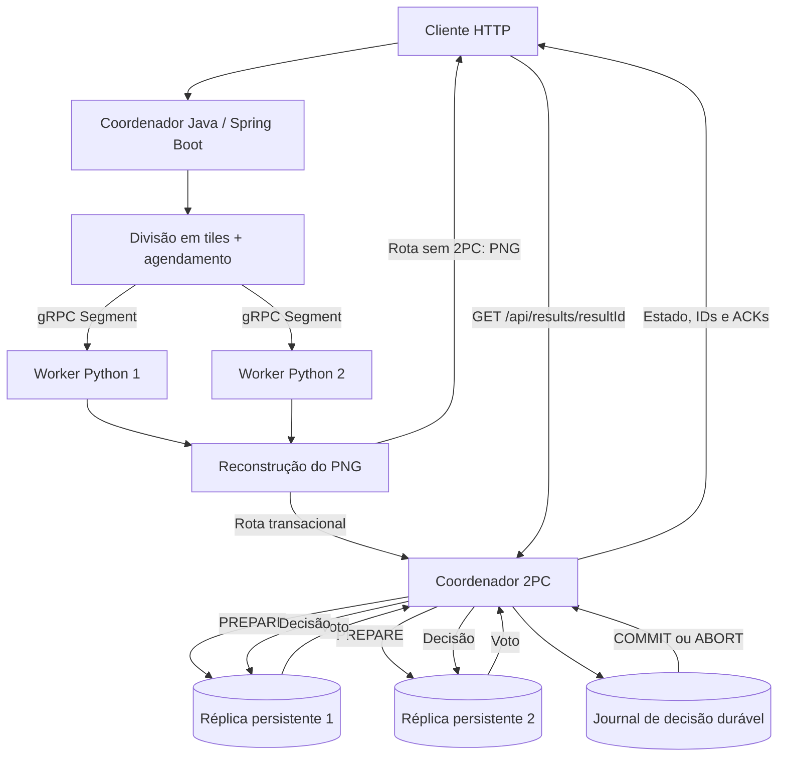
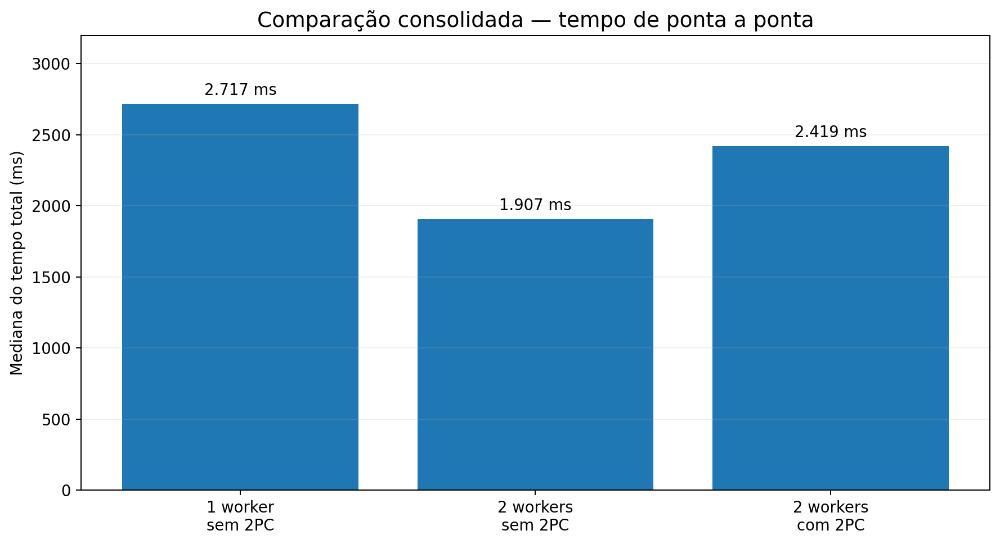

# Segmentação distribuída de imagens com SLIC, gRPC e Two-Phase Commit

**Trabalho Prático de Computação Distribuída · PUC Minas · 2026/2**

    

Sistema acadêmico que divide uma imagem em blocos, distribui sua **segmentação SLIC** entre workers Python por **gRPC**, recompõe o resultado em um coordenador **Java/Spring Boot** e, opcionalmente, **replica o PNG com Two-Phase Commit (2PC)**, armazenamento persistente e recuperação de decisões pendentes.

> **Qual versão utilizar?** A branch **`main`** contém a implementação da primeira entrega. A branch **`features/segunda_entrega`** acrescenta persistência, replicação, coordenador 2PC, testes de falhas e benchmarks. As instruções a seguir descrevem **`features/segunda_entrega`**. As funcionalidades da primeira entrega continuam disponíveis.

> **Importante:** o SLIC é executado **independentemente em cada bloco** da imagem. O resultado não equivale necessariamente a executar SLIC globalmente sobre a imagem inteira. O programa gera uma visualização PNG com contornos dos superpixels, não uma segmentação semântica.

## Índice

- [O projeto e a arquitetura](#o-projeto-e-a-arquitetura)
- [Requisitos e modos de execução](#requisitos-e-modos-de-execução)
- [Opção A: uma única máquina com Docker Compose](#opção-a-uma-única-máquina-com-docker-compose)
- [Opção B: dois computadores físicos — Lubuntu e Windows](#opção-b-dois-computadores-físicos--lubuntu-e-windows)
- [Exemplos de uso e endpoints](#exemplos-de-uso-e-endpoints)
- [Persistência, 2PC e recuperação](#persistência-2pc-e-recuperação)
- [Testes automatizados](#testes-automatizados)
- [Benchmarks e resultados experimentais](#benchmarks-e-resultados-experimentais)
- [Estrutura do repositório](#estrutura-do-repositório)
- [Solução de problemas e segurança](#solução-de-problemas-e-segurança)
- [Limitações e equipe](#limitações-e-equipe)

## O projeto e a arquitetura

O cliente envia uma imagem e parâmetros SLIC por **HTTP REST**. O coordenador Java divide a imagem em uma grade (por exemplo, 2 × 2), agenda os blocos concorrentemente e os envia a workers via **gRPC/Protocol Buffers**. Cada worker transforma seu bloco em superpixels com `scikit-image`, desenha os limites e retorna um PNG. O coordenador recompõe os blocos nas posições originais.

Quando o endpoint **transacional** é utilizado, o PNG montado passa também pela replicação persistente:



Os workers acumulam duas funções: **processamento SLIC** e **participação no 2PC**. Um worker não decide a transação global; apenas responde a `PREPARE`, `COMMIT`, `ABORT`, `ReplicaStatus` e `ReadReplica`. O coordenador registra sua decisão antes de distribuí-la.

**Tecnologias:** Java 17, Spring Boot 3.3.5, Maven, Python 3.11, gRPC, Protocol Buffers, NumPy, Pillow, `scikit-image`, SQLite, Docker/Compose e relógios lógicos de Lamport.

### Entregas implementadas

| Primeira entrega | Segunda entrega |
|---|---|
| Comunicação REST ↔ gRPC | Persistência de resultados e estados locais |
| Relógios lógicos de Lamport | Duas réplicas persistentes em workers distintos |
| Divisão e segmentação SLIC em tiles | Two-Phase Commit com decisão global durável |
| Agendamento e reconstrução | Recuperação de decisões e ACKs pendentes |
| Nova tentativa/failover básico do processamento | Testes de falha e benchmarks comparativos |

**Não confundir:** o endpoint de **segmentação sem 2PC** pode redirecionar tarefas SLIC para um worker disponível. Já a **gravação 2PC estrita** exige os votos de todos os participantes fixados na transação; não transforma automaticamente uma transação de duas réplicas em uma de uma réplica.

## Requisitos e modos de execução

- Git e Docker Engine, ou Docker Desktop com backend Linux/WSL2 no Windows.
- Para a opção A, **Docker Compose v2** (`docker compose`).
- Para a opção B, dois computadores na mesma rede local, conectividade TCP para a porta gRPC do Windows e firewall configurado adequadamente.
- `curl` para testar a API; `python3` no host somente para formatar JSON e executar o script de benchmark.
- Internet na primeira construção das imagens; memória e espaço em disco para Java, Maven, Python e imagens.

**Escolha uma opção:**

- **A — Uma máquina:** dois workers isolados em containers Docker na mesma máquina. Permite exercitar SLIC, 2PC e persistência, mas **não simula falhas de máquinas físicas independentes**.
- **B — Duas máquinas:** coordenador e um worker no notebook Lubuntu; o segundo worker no PC Windows. Foi a configuração utilizada nos testes reais do grupo.

Para baixar diretamente a segunda entrega:

```bash
git clone --branch features/segunda_entrega --single-branch https://github.com/FelipeSilva96/Trabalho_pratico_computacao_distribuida.git
cd Trabalho_pratico_computacao_distribuida
```

Quem já tem o repositório deve executar `git switch features/segunda_entrega` e atualizar a branch antes de construir imagens novas. Para obter **somente a primeira entrega**, use `git clone` sem `--branch` e mantenha a `main`.

## Opção A: uma única máquina com Docker Compose

A branch traz `docker-compose.yml`, herdado da primeira entrega. Ele não declara os **volumes persistentes** da implementação transacional. Para testar a **segunda entrega com armazenamento durável**, utilize **`docker-compose.segunda-entrega.yml`**, também presente na raiz do repositório.

> Se já estiver utilizando o ambiente manual da opção B na porta 8080, **não inicie o Compose em paralelo**, pois haverá conflito de portas. Não remova os volumes do ambiente existente para alternar de modo.

**ATENÇÃO: O BUILD A SEGUIR PODE DEMORAR VÁRIOS MINUTOS NA PRIMEIRA EXECUÇÃO, ENQUANTO O DOCKER E O MAVEN BAIXAM DEPENDÊNCIAS.**

```bash
docker compose -f docker-compose.segunda-entrega.yml up -d --build
```

Em distribuições Linux que exigem permissões administrativas, use `sudo docker compose ...`.

Verifique os serviços e a conectividade gRPC:

```bash
docker compose -f docker-compose.segunda-entrega.yml ps
curl -fsS http://127.0.0.1:8080/api/workers | python3 -m json.tool
```

Esperado: **`worker-1` e `worker-2`, ambos `UP`**. Aguarde a inicialização do Java se a primeira consulta ocorrer cedo demais. No Compose da segunda entrega, o HTTP fica exposto apenas em `127.0.0.1:8080` e o gRPC permanece na rede interna dos containers.

Os volumes nomeados preservam separadamente o journal do coordenador e os dados SQLite/PNG dos workers. Para encerrar **sem excluir os volumes**:

```bash
docker compose -f docker-compose.segunda-entrega.yml down
```

Para iniciar novamente sem reconstruir:

```bash
docker compose -f docker-compose.segunda-entrega.yml up -d
```

**NÃO USE `docker compose down -v` NEM REMOVA OS VOLUMES** se quiser preservar as transações e as réplicas.

## Opção B: dois computadores físicos — Lubuntu e Windows

### Topologia validada no laboratório

| Máquina | IP utilizado no laboratório | Processos |
|---|---|---|
| Notebook Lubuntu | `192.168.18.11` | `slic-worker-lubuntu` (gRPC interno) e `slic-coordinator-lan` (HTTP local:8080) |
| PC Windows | `192.168.18.2` | `slic-worker-windows` (TCP 50051) |

**Esses IPs são exemplos do laboratório, não valores universais.** Use os endereços atribuídos pelo roteador aos seus computadores. No Windows, obtenha o endereço de Ethernet com `ipconfig`; no Linux, use `ip -4 addr`. Confirme que ambos estão na mesma LAN e que a porta 50051/TCP do Windows aceita tráfego **apenas do notebook**. Não exponha o serviço gRPC à internet.

### B.1. PC Windows — construir e iniciar o worker

Abra o **PowerShell** na pasta do projeto. Execute os comandos abaixo **na primeira instalação**, quando o container ainda não existir. Se ele já existir, utilize apenas `docker start slic-worker-windows`.

**ATENÇÃO: A CONSTRUÇÃO DA IMAGEM DO WORKER PODE DEMORAR VÁRIOS MINUTOS NA PRIMEIRA EXECUÇÃO.**

```powershell
docker build -t cd-slic-worker .\worker
```

```powershell
docker run -d --name slic-worker-windows -p 50051:50051 -e WORKER_ID=worker-windows -e GRPC_PORT=50051 -e GRPC_THREADS=4 -e REPLICA_DIR=/app/data -v slic-replica-windows:/app/data --restart unless-stopped cd-slic-worker
```

Verifique:

```powershell
docker ps
docker logs --tail 20 slic-worker-windows
ipconfig
```

O log deverá informar `worker-windows iniciado na porta gRPC 50051`. Os dados da réplica ficam em `slic-replica-windows`, mesmo que o container seja recriado.

### B.2. Notebook Lubuntu — construir imagens e criar rede

No terminal, na raiz do projeto:

```bash
cd ~/Desktop/Trabalho_pratico_computacao_distribuida
```

**ATENÇÃO: OS DOIS BUILDS ABAIXO PODEM DEMORAR VÁRIOS MINUTOS, ESPECIALMENTE O MAVEN DO COORDENADOR.**

```bash
sudo docker build -t cd-slic-worker ./worker
sudo docker build -t cd-slic-coordinator ./coordinator
```

Se a rede ainda não existir, crie-a:

```bash
sudo docker network inspect cd-slic-lan >/dev/null 2>&1 || sudo docker network create cd-slic-lan
```

Inicie o worker do Lubuntu **somente se ele ainda não existir**:

```bash
sudo docker run -d \
  --name slic-worker-lubuntu \
  --network cd-slic-lan \
  -e WORKER_ID=worker-lubuntu \
  -e GRPC_PORT=50051 \
  -e GRPC_THREADS=4 \
  -e REPLICA_DIR=/app/data \
  -v slic-replica-lubuntu:/app/data \
  --restart unless-stopped \
  cd-slic-worker
```

Inicie o coordenador (substitua `192.168.18.2` se o IP do Windows for diferente):

```bash
sudo docker run -d \
  --name slic-coordinator-lan \
  --network cd-slic-lan \
  -p 127.0.0.1:8080:8080 \
  -e WORKER_ADDRESSES="slic-worker-lubuntu:50051,192.168.18.2:50051" \
  -e GRPC_DEADLINE_MS=15000 \
  -e REPLICATION_JOURNAL_DIR=/app/data/transactions \
  -v slic-coordinator-state:/app/data \
  --restart unless-stopped \
  cd-slic-coordinator
```

**Para reutilizar os containers existentes**, não repita `docker run`:

```bash
sudo docker start slic-worker-lubuntu
sudo docker start slic-coordinator-lan
```

Verifique:

```bash
sudo docker ps
sudo docker logs --tail 25 slic-coordinator-lan
curl -fsS http://127.0.0.1:8080/api/workers | python3 -m json.tool
```

Esperado: `worker-lubuntu` e `worker-windows`, ambos `UP`. Se o Windows responder `UNAVAILABLE`, confira o IP, a rede, o firewall e o estado do Docker Desktop. Reiniciar um container não garante que o aplicativo dentro dele já esteja pronto; consulte novamente após a inicialização.

> **Preservação de dados:** não execute `docker volume rm`, `docker compose down -v` ou `docker rm` sem distinguir container de volume. Mesmo depois de desligar os computadores, os volumes nomeados permanecem. O journal do coordenador deve ser montado exclusivamente por uma instância ativa, pois ele utiliza lock local.

## Exemplos de uso e endpoints

Execute os comandos `curl` a partir do **notebook Lubuntu** ou do host da opção A, na pasta onde está `imagem_teste_grande.jpg`.

### 1. Ver os workers

```bash
curl -fsS http://127.0.0.1:8080/api/workers | python3 -m json.tool
```

### 2. Segmentar sem transação

```bash
curl -fS \
  -F 'file=@imagem_teste_grande.jpg' \
  -F 'segments=500' \
  -F 'compactness=10.0' \
  -F 'rows=2' -F 'cols=2' \
  http://127.0.0.1:8080/api/segment-distributed \
  --output resultado_distribuido_local.png
```

Esse endpoint devolve **`image/png`** diretamente. Os cabeçalhos incluem `X-Request-Id`, `X-Tiles`, `X-Worker-Ids`, `X-Tile-Workers`, `X-Total-Time-Ms` e `X-Coordinator-Lamport`.

### 3. Segmentar e replicar com 2PC

```bash
curl -fsS \
  -F 'file=@imagem_teste_grande.jpg' \
  -F 'segments=500' -F 'compactness=10.0' \
  -F 'rows=2' -F 'cols=2' \
  http://127.0.0.1:8080/api/segment-transactional \
  | tee transacao_segmentacao.json \
  | python3 -m json.tool
```

O retorno é **JSON** com um objeto `transaction` contendo `transactionId`, `resultId`, `decision`, `status`, `replicaCount` e `acknowledgedCount`. No sucesso, `COMMIT`, `COMMITTED` e **2 ACKs de 2 réplicas**.

```bash
TX=$(python3 -c 'import json; print(json.load(open("transacao_segmentacao.json"))["transaction"]["transactionId"])')
RESULT=$(python3 -c 'import json; print(json.load(open("transacao_segmentacao.json"))["transaction"]["resultId"])')
curl -fsS "http://127.0.0.1:8080/api/transactions/$TX" | python3 -m json.tool
curl -fS "http://127.0.0.1:8080/api/results/$RESULT" --output resultado_transacional.png
sha256sum resultado_distribuido_local.png resultado_transacional.png
```

Se forem as mesmas configurações e uma execução determinística, os hashes devem coincidir; teste a igualdade dos resultados em vez de pressupô-la.

### 4. Replicar um PNG que já foi processado

```bash
curl -fsS -F 'file=@resultado_distribuido_local.png' \
  http://127.0.0.1:8080/api/replicas \
  | tee replicacao.json | python3 -m json.tool
```

Use `resultId` da resposta para consultar `GET /api/results/{resultId}`. O arquivo enviado deve ser PNG e ter até **14 MiB** no endpoint transacional. O gRPC utiliza limite de mensagem de 16 MiB, razão pela qual o endpoint aplica margem de segurança.

### Referência resumida da API

| Método | Endpoint | Função | Resposta |
|---|---|---|---|
| `GET` | `/api/health` | Saúde do coordenador | JSON |
| `GET` | `/api/workers` | Saúde dos workers gRPC | JSON |
| `POST` | `/api/segment` | SLIC da imagem inteira em um worker | PNG |
| `POST` | `/api/segment-distributed` | SLIC por tiles, sem 2PC | PNG |
| `POST` | `/api/segment-transactional` | SLIC por tiles seguido de 2PC | JSON |
| `POST` | `/api/replicas` | 2PC de PNG existente | JSON |
| `GET` | `/api/transactions/{transactionId}` | Estado de transação no journal | JSON |
| `POST` | `/api/transactions/recover` | Solicitar reenvio de decisões pendentes | JSON |
| `GET` | `/api/results/{resultId}` | Ler PNG confirmado de uma réplica válida | PNG |
| `POST` | `/api/classify` | Classificação legada, modo demo se sem modelo | JSON |

Parâmetros de segmentação: `file` obrigatório; `segments` (padrão 100; valor aceito 2–5000), `compactness` (padrão 8.0; positivo e finito), `rows`/`cols` (padrão 2×2; 1–8 cada). O coordenador valida limites de dimensão, tamanho e tiles.

A página HTML na raiz (`GET /`) é uma interface **legada de classificação de resíduos**, não a interface gráfica do SLIC. A segmentação é acessada pelas APIs indicadas.

## Persistência, 2PC e recuperação

Cada worker persiste os bytes PNG e os metadados dos resultados em armazenamento local e mantém um **journal de participante SQLite**. Durante `PREPARE`, registra uma versão preparada antes de responder ao coordenador. Uma transação preparada não se torna visível por `ReadReplica` até `COMMIT`.

O coordenador mantém um **journal de decisão em arquivos persistentes**, realizando escrita sincronizada e renomeação atômica no filesystem compatível. A decisão global `COMMIT`/`ABORT` é registrada **antes** de ser enviada aos workers. O job de recuperação tenta reenviar decisões sem ACK, inclusive após reinicialização; a rotina é agendada aproximadamente a cada **15 s** por padrão.

| Estado público | Significado |
|---|---|
| `PREPARING` | Transação iniciada, decisão global ainda não consolidada |
| `COMMIT_PENDING` | `COMMIT` persistido; faltam ACKs |
| `COMMITTED` | `COMMIT` persistido e ACK de todos os participantes |
| `ABORT_PENDING` | `ABORT` persistido; faltam ACKs |
| `ABORTED` | `ABORT` persistido e ACK de todos os participantes |

**Regra de publicação:** a API REST `/api/results/{id}` só devolve um resultado depois da decisão `COMMIT` **e de todos os ACKs**. A leitura tenta outro participante se a réplica preferencial estiver inacessível ou inválida e verifica o SHA-256. Um resultado abortado ou com COMMIT incompleto retorna erro (tipicamente HTTP **409**).

**Regra de disponibilidade:** com dois participantes exigidos, uma falha antes de todos os votos conduz a `ABORT`; 2PC **não** é um protocolo de consenso tolerante a partições nem permite confirmação irrestrita com menos votos. Depois de persistir `COMMIT`, o coordenador **não** pode revertê-lo para `ABORT` só porque perdeu um ACK.

### Experimentos de falha já realizados

Foram executados e registrados na segunda entrega:

1. **Replicação em dois computadores:** PNG recuperado com mesmo SHA-256 do original.
2. **Durabilidade:** transação confirmada consultável após reinício do Java e após desligamento dos dois computadores.
3. **Falha de worker durante leitura:** o Lubuntu foi desligado e a leitura recuperou PNG idêntico da réplica Windows.
4. **Falha antes de votar:** Windows indisponível no `PREPARE` → `ABORT_PENDING`, depois `ABORTED` com dois ACKs ao retornar; consulta ao resultado abortado retornou HTTP 409.
5. **Falha depois da decisão:** injeção de encerramento do processo Python no Windows no primeiro `CommitReplica` (código 77), após `PREPARED`; decisão `COMMIT` ficou `COMMIT_PENDING` com um ACK, sendo recuperada para `COMMITTED` com dois ACKs e SHA-256 preservado.

O teste 5 utiliza injeção **desativada por padrão**; consulte [`docs/ETAPA_5_FALHA_COMMIT_PENDENTE.md`](docs/ETAPA_5_FALHA_COMMIT_PENDENTE.md) para reexecutá-lo de forma controlada. Os procedimentos gerais de persistência, 2PC e recuperação estão em [`docs/ETAPA_4_COORDENADOR_2PC.md`](docs/ETAPA_4_COORDENADOR_2PC.md).

Esses testes **não** demonstram tolerância a todas as possíveis falhas de hardware ou energia, nem eleições/consenso. Para não afetar seus dados, execute cenários destrutivos **somente em ambiente de laboratório**.

## Testes automatizados

Foram validados **24 testes Python** (persistência, idempotência, integridade, participante 2PC e injeção de falhas), além dos testes Java/JUnit do coordenador e do processamento de tiles, todos com sucesso na etapa de implementação.

**ATENÇÃO: O MAVEN PODE LEVAR VÁRIOS MINUTOS SE PRECISAR BAIXAR DEPENDÊNCIAS.**

Na raiz do projeto (Lubuntu):

```bash
sudo docker run --rm \
  -v "$PWD/coordinator:/app" -w /app \
  maven:3.9.9-eclipse-temurin-17 mvn -B test
```

Testes Python (executados dentro da imagem do worker):

```bash
sudo docker run --rm \
  -v "$PWD/worker:/src:ro" -w /src \
  cd-slic-worker python -m unittest discover -s tests -v
```

O `Dockerfile` do coordenador compila com testes pulados (`-DskipTests`). Portanto, **construir a imagem não substitui rodar `mvn test`**. As duas cópias de `classifier.proto` precisam permanecer compatíveis em Java e Python.

## Benchmarks e resultados experimentais

Os experimentos foram executados em **três rodadas**, cada uma com 2 aquecimentos e 10 medições por cenário. Foram **90 medições válidas** (30 por cenário; aquecimentos excluídos), sem falhas e com saída PNG de **4.607.902 bytes** e SHA-256 idêntico:

```text
870f39d917ae03fae238b882fc957b7ed85c5b944d9abc8c252b982dda2b9f62
```

**Entrada:** `imagem_teste_grande.jpg` (1920×1080), `segments=500`, `compactness=10.0`, grade 2×2. O caso com um worker foi executado no Lubuntu; o distribuído incluiu o PC Windows.

| Indicador (tempo ponta a ponta) | 1 worker | 2 workers | 2 workers + 2PC |
|---|---:|---:|---:|
| Média (ms) | 2.796,76 | 1.956,47 | 2.482,78 |
| **Mediana (ms)** | **2.717,48** | **1.907,29** | **2.419,33** |
| Desvio-padrão amostral (ms) | 138,54 | 145,89 | 132,06 |
| P95 (ms) | 3.067,81 | 2.200,92 | 2.704,78 |
| Medições válidas | 30 | 30 | 30 |

**Speedup observado:** `2.717,48 / 1.907,29 ≈ 1,425×` (**29,81% menos latência** na mediana). **Sobrecusto da opção com 2PC + recuperação do PNG:** `~26,85%` em relação aos dois workers sem 2PC. Mesmo com 2PC, a mediana ficou **10,97% abaixo** da configuração com apenas um worker.

O custo medido **não é só o protocolo 2PC**: inclui comunicação, replicação persistente e um `GET` adicional para recuperar o PNG, permitindo ao cliente obter o arquivo final em todos os cenários. A execução de um único worker **não é SLIC sequencial puro**, pois os quatro tiles ainda podem ser processados concorrentemente. Os computadores também têm hardware e sistemas diferentes; não extrapole os percentuais para clusters homogêneos ou outras imagens.



Arquivos reproduzíveis:

- Script: [`benchmarks/benchmark_slic.py`](benchmarks/benchmark_slic.py).
- Metodologia: [`docs/ETAPA_6_BENCHMARKS.md`](docs/ETAPA_6_BENCHMARKS.md).
- Resultados brutos: `benchmarks/resultados/rodada_01`, `rodada_02`, `rodada_03` (CSV e JSON).
- Análise consolidada: [`benchmarks/analise/ANALISE_BENCHMARKS.md`](benchmarks/analise/ANALISE_BENCHMARKS.md).
- Gráficos: [`benchmarks/analise/`](benchmarks/analise/).

### Reproduzir os benchmarks com duas máquinas

Depois de iniciar a infraestrutura da opção B, crie **uma instância adicional do coordenador** para a configuração com um worker. Ela deve utilizar **journal e volume próprios**, pois o journal não permite duas instâncias simultâneas no mesmo diretório.

```bash
sudo docker run -d \
  --name slic-coordinator-single-benchmark \
  --network cd-slic-lan \
  -p 127.0.0.1:8081:8080 \
  -e WORKER_ADDRESSES="slic-worker-lubuntu:50051" \
  -e GRPC_DEADLINE_MS=15000 \
  -e REPLICATION_JOURNAL_DIR=/app/data/transactions \
  -v slic-benchmark-single-state:/app/data \
  cd-slic-coordinator
```

Se o container já existir, utilize `sudo docker start slic-coordinator-single-benchmark` em vez de repetir `docker run`.

**ATENÇÃO: ESTA BATERIA EXECUTA 36 SEGMENTAÇÕES FULL HD E PODE DEMORAR VÁRIOS MINUTOS. EVITE TAREFAS PESADAS E NÃO DESLIGUE OS COMPUTADORES.**

```bash
python3 benchmarks/benchmark_slic.py \
  --input imagem_teste_grande.jpg \
  --single-url http://127.0.0.1:8081 \
  --dual-url http://127.0.0.1:8080 \
  --segments 500 --compactness 10.0 --rows 2 --cols 2 \
  --warmups 2 --repeats 10 --seed 42 \
  --expected-sha256 870f39d917ae03fae238b882fc957b7ed85c5b944d9abc8c252b982dda2b9f62 \
  --output-dir benchmarks/resultados/nova_rodada
```

Para reproduzir as três rodadas originais, use sementes `42`, `43`, `44` e diretórios separados. A ordem dos cenários é embaralhada de modo reprodutível; os testes são sequenciais entre requisições. Compare média, mediana, desvio-padrão e P95 usando os arquivos gerados.

## Estrutura do repositório

```text
.
├── coordinator/
│   ├── Dockerfile, pom.xml
│   └── src/
│       ├── main/java/br/pucminas/cd/waste/
│       │   ├── controller/      # APIs REST; inclui ReplicationController
│       │   ├── grpc/            # WorkerClient, WorkerPool
│       │   ├── image/           # divisão e montagem dos tiles
│       │   ├── replication/     # ReplicationCoordinator e TransactionJournal
│       │   ├── clock/           # relógio lógico de Lamport
│       │   └── service/         # segmentação distribuída
│       ├── main/proto/classifier.proto
│       └── test/
├── worker/
│   ├── app.py, segmenter.py, classifier.py, lamport.py
│   ├── replica_store.py, transaction_participant.py
│   ├── fault_injection.py, replica_rpc_cli.py
│   ├── proto/classifier.proto
│   └── tests/
├── benchmarks/
│   ├── benchmark_slic.py
│   ├── resultados/rodada_{01,02,03}/
│   └── analise/               # estatísticas e quatro gráficos
├── docs/                      # guias das etapas e testes
├── docker-compose.yml         # configuração herdada da primeira entrega
├── docker-compose.segunda-entrega.yml
├── imagem_teste_grande.jpg
├── .gitignore
└── README.md
```

Arquivos de build Maven em `coordinator/target/` são ignorados pelo Git; não são código-fonte. Arquivos de saída de experimentos locais podem ficar não monitorados, e isso não implica falha no projeto.

## Solução de problemas e segurança

| Sintoma | Como investigar |
|---|---|
| `curl: (7) Failed to connect ... 8080` | O coordenador não está iniciado: `sudo docker ps -a`; reinicie o container existente com `sudo docker start slic-coordinator-lan`. |
| Um worker aparece `UNAVAILABLE` | Verifique `docker ps`, logs, IP da Ethernet do Windows, porta 50051 e regra de firewall. Aguarde o processo Python iniciar. |
| `UNIMPLEMENTED` em chamada 2PC | Contrato `.proto`/imagem Docker antigos; atualize a branch e reconstrua a imagem do worker correspondente. |
| `ABORT_PENDING` | Uma decisão `ABORT` já foi persistida, mas faltam ACKs. Restaure o worker, depois execute `POST /api/transactions/recover`. |
| `COMMIT_PENDING` | A decisão `COMMIT` é durável; não altere manualmente para `ABORT`. Restaure o worker e faça recovery. |
| HTTP 409 ao ler PNG | A transação foi abortada ou ainda não está completamente confirmada. Consulte `/api/transactions/{id}`. |
| `docker run` diz que o nome já existe | Use `docker start` para reativar o container configurado anteriormente. |
| `permission denied` no Docker Linux | Use `sudo docker ...` ou configure o acesso ao daemon conscientemente. |
| Erro de porta `8080` em uso | Não execute os dois coordenadores de demonstração na mesma porta; escolha o modo de execução antes. |
| Aviso sobre `buildx` no Lubuntu | Pode ser apenas um aviso do builder legado; confirme se o build terminou com sucesso. |
| Resultados SLIC diferem nas bordas dos tiles | É uma limitação do processamento independente por blocos. |
| `mvn test` produz muitos arquivos | Normal: resultados de build em `coordinator/target/` são ignorados no Git. |

**Segurança:** a API REST e o gRPC não oferecem autenticação; o gRPC usa **plaintext**, sem TLS. Não publique as portas desses serviços na internet. No laboratório com duas máquinas, mantenha a porta `50051/TCP` do Windows restrita ao notebook na rede privada. A demonstração não é um serviço pronto para produção.

**Persistência:** o journal do coordenador pressupõe filesystem que aceite *rename* atômico e escrita sincronizada (*fsync*). Os volumes dos workers armazenam bancos SQLite e arquivos PNG. Evite apagar, recriar sem montar os volumes ou modificar manualmente os dados duráveis. Se os endereços dos participantes mudarem enquanto houver decisões pendentes, o recovery pode deixar de alcançá-los.

## Limitações e equipe

**Limitações conhecidas:** SLIC independente por tile (sem reconciliação nas bordas); coordenador único e ponto único de falha; 2PC bloqueante; conjunto fixo de participantes sem consenso/eleição; ausência de TLS e autenticação; limite de PNG transacional de 14 MiB, sem streaming; benchmarks limitados a uma imagem e a máquinas heterogêneas. Os experimentos de falha cobrem cenários específicos e **não** todas as possíveis janelas de falha, nem falhas físicas de disco/energia.

**Integrantes do grupo:**

- Mateus Resende Ottoni
- Felipe Pereira da Silva
- Rikerson Antônio Freitas
- Kauan Gabriel Pereira
- Diego Feitosa

**Uso de IA:** o grupo utilizou ferramentas de IA como apoio técnico e de documentação. A declaração acadêmica precisa identificar os usos efetivos de IA, conforme as regras da disciplina; não é adequado apresentar textos ou experimentos gerados por IA como trabalho ou execução exclusivamente humana.

**Referências de implementação:** [`docs/ETAPA_4_COORDENADOR_2PC.md`](docs/ETAPA_4_COORDENADOR_2PC.md), [`docs/ETAPA_5_FALHA_COMMIT_PENDENTE.md`](docs/ETAPA_5_FALHA_COMMIT_PENDENTE.md), [`docs/ETAPA_6_BENCHMARKS.md`](docs/ETAPA_6_BENCHMARKS.md) e [`benchmarks/analise/ANALISE_BENCHMARKS.md`](benchmarks/analise/ANALISE_BENCHMARKS.md).

---

**Estado documentado:** branch `features/segunda_entrega`, após o commit de limpeza `6cf4db8`, novembro de 2026. A branch `main` continua representando a primeira entrega até eventual integração explícita.
